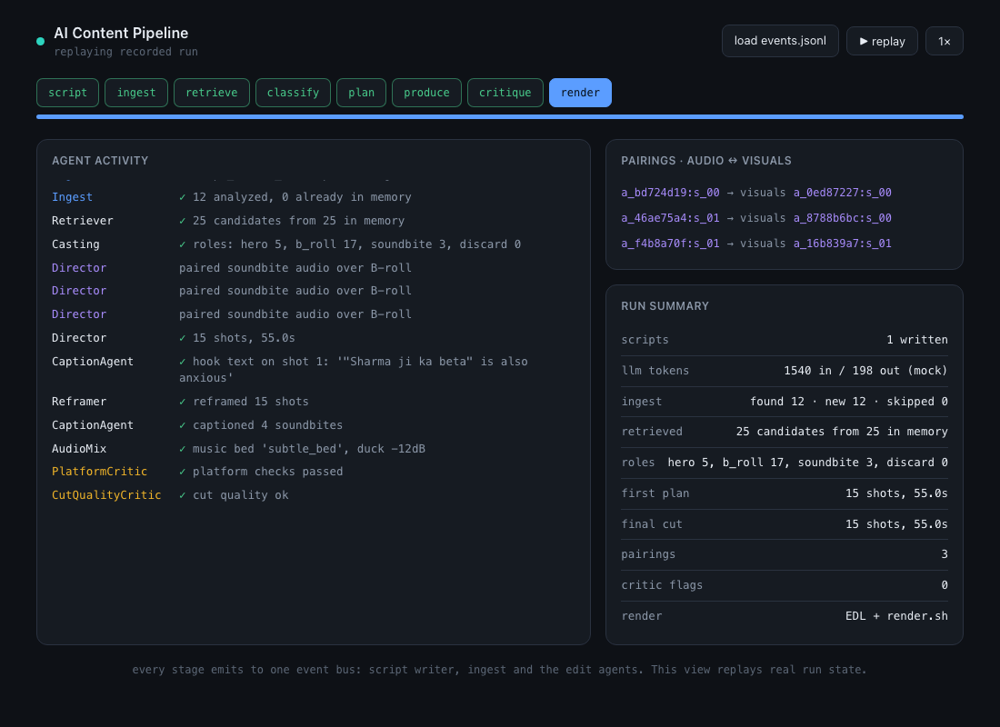
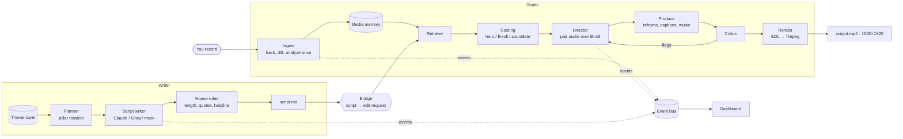

# AI Content Pipeline

**Scripts in your voice, edited into shorts.** An LLM script writer and an agentic video editor joined into one pipeline: it plans a week of ideas, writes each script as validated structured output in a channel's voice, and once you've recorded, analyzes your footage *once*, directs an edit from the script and renders a vertical short. Every stage reports to one event bus, so you can watch the run in a dashboard.

[](https://github.com/nishitdixit/ai-content-pipeline/actions/workflows/ci.yml)




```bash
pip install -e .
acp demo          # offline: writes a script, synthesizes footage, ingests it, edits a short
```

No API keys, no model weights, no ffmpeg needed for the demo. With ffmpeg installed it also renders `output.mp4`; [CI does exactly that](.github/workflows/ci.yml) on every push.

---

## Why this exists

A daily short-form channel is mostly work *around* the video: deciding what to say, writing it so it sounds like you, then cutting raw takes into something watchable. This project automates that loop for a real channel ([Thahrav](profiles/thahrav/), Hinglish shorts about slowing down) so the creator's part is reviewing a script and recording it. Two design commitments keep it useful and honest:

- **The LLM never parses free text and never invents facts about you.** Scripts come back as a pydantic schema; personal details come back as `[placeholders]` to fill; every quote is listed for verification.
- **The editor reasons about footage it has already measured.** Clips are analyzed once into a memory index; every edit is a query over that index, not a re-scan.

## How it works



| Stage | What happens | Where |
|---|---|---|
| **Plan** | Picks the next unused idea per day from a markdown theme bank, following the channel's weekly pillar rotation. Asks the LLM for new ideas when a pillar runs dry. | [`writer/plan.py`](src/content_pipeline/writer/plan.py) |
| **Write** | One structured call per script (JSON schema output on Claude; JSON mode + validation + up to 3 repair turns on Groq). One automatic rewrite if the length is off. | [`writer/scriptgen.py`](src/content_pipeline/writer/scriptgen.py), [`llm.py`](src/content_pipeline/llm.py) |
| **House rules** | Deterministic, not prompted: hashtag normalisation, a helpline line on sensitive topics, warnings for placeholders, quotes to verify and titles too long for YouTube. | [`writer/scriptgen.py`](src/content_pipeline/writer/scriptgen.py) |
| **Bridge** | Reads the script back and builds the edit request: topic for retrieval, target length and pacing from the channel, the on-screen hook as a caption over the opening shot. | [`bridge.py`](src/content_pipeline/bridge.py) |
| **Ingest** | Content hash = identity, so re-ingesting a folder only analyzes new clips. Long takes are windowed (~4s) and each window is scored per modality: visual, audio, speech, emotion. | [`studio/memory/ingest.py`](src/content_pipeline/studio/memory/ingest.py) |
| **Direct** | Assigns roles instead of one blended score, then **pairs a soundbite's audio over a B-roll's visuals**, so a great line on ugly footage and great footage with wind noise become one strong shot. Heroes build to a peak. | [`studio/agents/director.py`](src/content_pipeline/studio/agents/director.py) |
| **Critique** | Platform critic (length, shot count, hook window) and cut-quality critic (too-short shots, jump cuts). Flags trigger one revise pass. | [`studio/agents/critics.py`](src/content_pipeline/studio/agents/critics.py) |
| **Render** | The EDL is the contract: a dumb renderer turns it into per-shot 9:16 segments and concatenates them. It always writes `edl.json` and a reproducible `render.sh`. | [`studio/skills/render.py`](src/content_pipeline/studio/skills/render.py) |

## Quickstart

Requires Python 3.11+. ffmpeg is optional (needed only for real media and the final encode).

```bash
git clone https://github.com/nishitdixit/ai-content-pipeline
cd ai-content-pipeline
python -m venv .venv && source .venv/bin/activate
pip install -e ".[all,dev]"

acp demo                      # the whole pipeline, offline, in ./demo_run
open demo_run/dashboard.html  # replay the run
pytest                        # 40 tests, no network
```

For real scripts, copy `.env.example` to `.env` and add `ANTHROPIC_API_KEY` or `GROQ_API_KEY`:

```bash
acp doctor                                   # checks profile, keys, skills, ffmpeg, ideas left
acp plan-week --dry-run                      # which ideas next week would use, no LLM calls
acp plan-week                                # write next Monday-Sunday
acp script --idea "Exam results aur self-worth" --pillar P2
acp compare --n 5                            # blind A/B: the same ideas from Claude and Groq

acp ingest ~/takes --project ./studio        # analyze once; re-run as you add clips
acp edit ./studio --script profiles/thahrav/scripts/2026-10-12_25-tak-settle-myth.md
acp edit ./studio "motivational short, 10 shots in 30s"   # or a plain brief
acp reedit ./studio "make the opening punchier"
```

## Sample output

The [`profiles/thahrav/scripts/`](profiles/thahrav/scripts/) folder holds the first real week the writer produced (Groq, Llama 3.3 70B; 132-176 spoken words each, every one inside the channel's 110-190 limit). An excerpt:

> **Hook:** 25 tak settle ho jaana zaroori hai?
>
> **Reframe:** Ruko zara. Ye 25 ki deadline kahaan se aayi? Na tumhare parents ne, na tumhara dil. Ye society ka ek narrative hai—"abhi settle ho jao". Kabhi koi 22 mein startup chalata hai, kabhi 38 mein apna sukoon milta hai. Dono sahi.
>
> **Takeaway:** Aaj ek minute lo, apni khud ki timeline likho—sirf tumhare liye, koi aur nahi.

And the edit the studio directs from that kind of script (`acp demo`, abridged):

```text
variant: from-script | 15 shots | 55.0s
   1. [b_roll   ] dream_vista_drone.mp4      2.0s  caption: <the script's on-screen hook>
       reason: opening hook — strongest visual to stop the scroll
   2. [soundbite] motivational_rise_wide.mp4 4.0s  audio<-struggle_speech_quote.mp4
       reason: soundbite — strong spoken line over covering B-roll
   ...
   8. [hero     ] triumph_summit_hero.mp4    3.0s
       reason: hero beat — re-lifts momentum on the staircase
   ...
  15. [hero     ] finish_hero_peak.mp4       4.0s
       reason: closing summit — strongest hero, full frame, longest hold
```

Every shot carries a `reason`: the EDL is an audit trail, not just a cut list.

## Design decisions

- **Channel profiles are data.** Pillars, rotation, series, word limits, the system prompt, voice guide and helpline live in [`profiles/thahrav/`](profiles/thahrav/). A new channel is a new folder; editing the voice guide retunes the scripts with no code change.
- **Structured output everywhere.** The writer's contract is a pydantic model with `extra="forbid"`, inlined into a strict JSON schema. Rules that must always hold (helpline, hashtags, length checks) run in code after generation, not as prompt instructions.
- **Analyze once, query forever.** Ingest is idempotent and incremental by content hash; `--force` re-analyzes after changing perception logic. Asset records keep the skill versions that produced them.
- **Never blend modalities.** Per-axis scores plus roles, so asymmetric clips are paired rather than discarded.
- **Every capability is a swappable adapter.** Perception, production and render are `Skill`s behind typed contracts. `mock → hosted → self-hosted` is a [config change](config/providers.json); a remote skill activates automatically when its API key is set (Deepgram transcription is wired today).
- **One event bus, three consumers.** Console output, a JSONL log and the dashboard all read the same events, including per-call LLM token usage and latency. The dashboard is a view of real state, not a progress bar.
- **Offline by default.** A mock LLM and mock perception let the whole pipeline, its tests and CI run with no keys, so edit logic can be validated before paying for models.

More in [`docs/architecture.md`](docs/architecture.md) and the original design docs in [`docs/studio/`](docs/studio/).

## Project layout

```text
src/content_pipeline/
  cli.py          acp: writer, studio and pipeline commands
  bridge.py       script.md → edit request
  llm.py          Claude, Groq and mock providers, usage reporting
  events.py       event bus + JSONL recorder
  config.py       .env, profile and config paths
  writer/         channel profile, planner, prompts, script generation, theme bank, Notion mirror
  studio/         media memory, skills (perception / production / render), agents, orchestrator
profiles/thahrav/ a real channel: channel.json, prompt, voice guide, theme bank, generated scripts
config/           studio skill providers and edit styles
dashboard/        single-file run dashboard
docs/             architecture and design docs
tests/            writer, studio and end-to-end pipeline tests
```

## Status and roadmap

| Area | Today | Next |
|---|---|---|
| Script writer | **Real**: Claude and Groq providers (the sample week was written with Groq), blind A/B comparison, Notion mirror, weekly scheduling via launchd | Evals: a rubric-scored golden set run in CI |
| Transcription | **Real** with `DEEPGRAM_API_KEY` (word timestamps, sliced per window); mock otherwise | Local Whisper adapter |
| Visual / audio / emotion scoring | Heuristic + mock adapters, deterministic per clip | A vision model for shot quality; match takes to script sections via the transcript |
| Edit logic (roles, pairing, critics, EDL) | **Real**, tested | Learn thresholds from which cuts get kept |
| Render | **Real** ffmpeg pipeline (CI renders on every push) | Burned-in captions, music bed mixing |
| Publishing + analytics | Planned ([original plan](profiles/thahrav/pipeline-plan.md)) | YouTube/Instagram upload, feed performance back into planning |

## History

This repository joins two projects that started separately: **AI Video Studio** (the agentic editor, June 2026) and the **Thahrav engine** (the script writer, October 2026). Their original commits are kept with their real authored dates; the merge into one package, the bridge, the shared LLM layer and the dashboard came after.

## License

[MIT](LICENSE)
