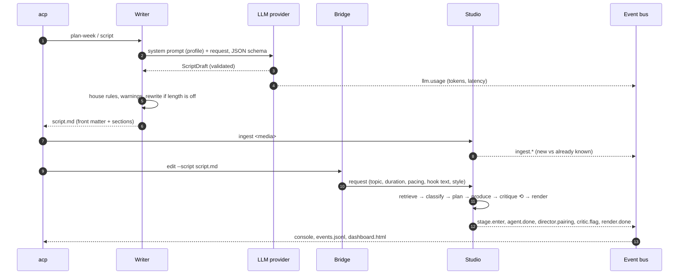

# Architecture

The pipeline has two halves that meet at a file: the **writer** produces a script, the **studio** turns footage into a short, and the **bridge** reads the script back as the studio's edit request. A single **event bus** runs through all of it.

## Writer

| Module | Responsibility |
|---|---|
| `writer/channel.py` | Loads `profiles/<name>/channel.json`: pillars, series rules, weekly rotation, word limits, verb forms, sensitive-topic footer, edit settings. |
| `writer/prompts.py` | Builds the system prompt from the profile's `prompt.md`, voice guide and the worked example in the script template. Editing those files retunes output. |
| `writer/models.py` | The output contract: `ScriptDraft` and `IdeaList` as pydantic models with `extra="forbid"`, exported as strict, `$ref`-free JSON schema. |
| `writer/scriptgen.py` | One generation, one rewrite if the spoken length is outside the profile's range, then deterministic finalisation and review warnings. |
| `writer/plan.py` | Picks the day's pillar and the first unused idea, writes, marks the idea used, saves after every day so a crash keeps finished work, suggests new ideas when a pillar runs out. Idempotent: existing days are skipped unless `--force`. |
| `writer/themes.py` | Reads and edits the markdown theme bank in place, which stays the human-editable source of truth. |
| `writer/notion_sync.py` | Optional mirror. A Notion failure never loses the local file. |

## LLM layer (`llm.py`)

All providers implement `generate(system, user, schema) -> schema instance`.

- **Claude**: native JSON-schema output, the system prompt marked for caching (it is identical for every script in a run), server-side fallback on a refusal, explicit handling of `refusal` and `max_tokens` stop reasons.
- **Groq**: JSON mode with the schema in the prompt, then pydantic validation; on a mismatch the validation error is sent back for up to three repair turns.
- **Mock**: deterministic drafts for tests, CI and `acp demo`.

Each call reports `{provider, model, schema, input_tokens, output_tokens, cache_read_tokens, attempts, latency_ms}` through a callback that the CLI forwards to the event bus.

## Studio

The design rationale lives in [`docs/studio/`](studio/). In short:

| Layer | Pieces |
|---|---|
| **Memory** | `fingerprint` (content hash = identity), `ingest` (incremental diff, windowing, per-window scoring), `store` (JSON records; the interface is small enough to swap for Postgres), `index` (vector, keyword and metadata views). |
| **Skills** | Stateless, versioned capabilities behind a registry: scene detection, visual / audio / speech / emotion scoring, embeddings, transcription (mock or Deepgram), reframe, captions, music, render. `config/providers.json` picks the implementation; a remote skill wins automatically when its key is set. |
| **Agents** | `NarrativeDirectorAgent` (casting roles, pairing soundbites over B-roll, hero staircase, opening shot sized to the hook window), `PlatformCritic`, `CutQualityCritic`. They read and write a shared blackboard. |
| **Orchestrator** | retrieve → classify → plan → produce → critique → one revise pass → render. The revise pass rescales shots to the target length, keeps the opening shot inside the hook window and never runs a shot past the footage it was cut from. |
| **EDL** | The contract between reasoning and rendering. Every shot has a `reason`, optional `audio_from` for paired audio, and its source bounds. |
| **Styles** | `config/styles/*.json`: scoring weights, role thresholds, platform rules and music per genre. |

## Bridge (`bridge.py`)

`read_script()` parses the script markdown (front matter, sections, on-screen hook). `edit_request()` combines it with the channel's `edit` settings into the request the studio's session accepts: retrieval text from the title, idea and takeaway; duration and shot count from the channel's pacing; the on-screen hook as a caption on shot 1; the channel's edit style.

## Events

`events.py` is a tiny synchronous pub/sub with a console printer and a JSONL recorder. The dashboard is a static page that replays a JSONL stream; `acp demo` writes a copy with the run embedded so it opens from disk. Event types:

| Type | Emitted by | Payload |
|---|---|---|
| `stage.enter` | CLI, ingest, orchestrator | `stage` |
| `llm.usage` | LLM providers | tokens, latency, attempts |
| `agent.done` / `agent.running` | writer, agents | `agent`, `result` / `doing` |
| `ingest.scan`, `ingest.skip`, `ingest.analyzing`, `ingest.analyzed`, `ingest.done` | ingest | file, asset, counts |
| `director.pairing` | director | `audio_from`, `visuals_from` |
| `critic.flag` | critics, writer failures | `agent`, `issue` |
| `render.done` | orchestrator | output, rendered, shots, duration |

## Testing

- `tests/writer`: planning, idempotency, failure isolation, the Notion mirror contract, prompt assembly, schema strictness, house rules. They run on a temporary copy of the real profile with every idea marked unused.
- `tests/studio`: fingerprinting, incremental ingest, role classification, pairing, retrieval ranking.
- `tests/test_pipeline.py`: the profile loader, the bridge on a real generated script, the mock provider, the studio fixes (style music, hook window, source bounds) and `acp demo` end to end.
- CI runs the suite on Python 3.11-3.13 without ffmpeg, then runs `acp demo` with ffmpeg and checks that a 1080×1920 `output.mp4` was rendered.
