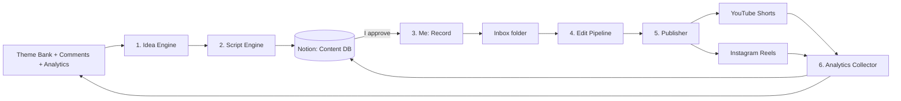

# 06: System Architecture (plan only, no code yet)

## Goal
Automate everything around the recording. My only manual steps are **approving scripts** (weekly) and **recording** (daily or batched).

## Pipeline overview



## Components

### 1. Idea Engine (Phase 1)
- **Input:** the theme bank, last week's top-performing topics, saved viewer comments, an optional festival/date calendar (e.g. Diwali, exam season, New Year)
- **Output:** 7 ideas for the week, balanced across pillars according to [the content strategy](02-content-strategy.md)
- **How:** an LLM call with the pillar mix and recent performance as context; it removes duplicates of topics used in the last 60 days
- **Runs:** weekly on Saturday night, so the drafts are ready for the Sunday review

### 2. Script Engine (Phase 1)
- **Input:** one idea plus the [voice & style guide](03-voice-and-style-guide.md), used as the system prompt
- **Output, per video:**
  - Hook (two alternatives to choose from)
  - Full script in Roman Hinglish, timed to about 60s (roughly 130-160 spoken words)
  - One-line takeaway
  - YouTube title (two options), Instagram caption, 3-5 hashtags
  - On-screen text for the cover/thumbnail
  - **Quote verification flag:** every scripture or quote is listed separately with its claimed source, so I can check it
- **How:** **structured output** (a JSON schema), never parsing free text. This fixes the main bug in `content_writer`.
- **LLM provider:** Claude Opus 5.5 by default, with Groq Llama 3.3 70B as the alternative (D11 in [decisions](10-decisions-and-risks.md)). `thahrav compare` runs the blind test.

### 3. Recording (manual: me)
- Covered in [the workflow](04-workflow.md) and [recording setup](05-recording-setup.md)
- **Handoff:** the chosen take goes into a synced folder (`Thahrav/inbox/`) on iCloud Drive or Google Drive, so I can drop it straight from the phone

### 4. Edit Pipeline (Phase 2)
Runs automatically when a new file appears in the inbox.

| Step | Tool (planned) | Notes |
|---|---|---|
| 4.1 Audio cleanup | ffmpeg filters (noise reduction, loudness normalisation to about -14 LUFS) | Uses the 3s of silence at the start of each take as a noise profile |
| 4.2 Silence and stumble trimming | `auto-editor` or a custom ffmpeg cut list | Removes pauses over about 0.6s, but keeps the intentional pause after the hook |
| 4.3 Transcription | Whisper (local `faster-whisper`, large-v3) | Handles mixed Hindi and English. Output is word-level timestamps. |
| 4.4 Transliteration fix | LLM pass | Whisper may output Devanagari for Hindi words; convert to Roman Hinglish so subtitles match the style |
| 4.5 Subtitles | ASS subtitle file, burned in with ffmpeg | 2-4 words at a time, bold, centred in the lower third, keyword highlighted |
| 4.6 Hook text overlay | ffmpeg drawtext | The hook line on screen for the first 3s |
| 4.7 Background music | A royalty-free track from my own library, ducked under the voice | Track rotates by mood tag; must be licensed for Instagram and YouTube |
| 4.8 Cover frame | Pick a frame plus text overlay | For the Shorts and Reels cover |
| 4.9 Render | ffmpeg → 1080×1920, H.264, AAC | Saved to `Thahrav/ready/`; status in Notion set to `Edited` |

**Human check:** in the first month of Phase 2 I watch every edited video before it's scheduled. After that, spot checks only.

### 5. Publisher (Phase 3)
| Platform | API | Important constraints |
|---|---|---|
| YouTube Shorts | YouTube Data API v3 (`videos.insert`, scheduling with `status.publishAt`) | Uploads from an **unverified API project are restricted to private** until the project passes Google's API audit. Plan for the audit, or keep manual scheduling in YouTube Studio as a fallback. Daily upload quota applies. |
| Instagram Reels | Instagram Graph API content publishing | Needs an **Instagram Professional (Creator/Business) account linked to a Facebook Page** and a Meta app. The video must be at a **public URL** when published, so a temporary hosting step is needed. There's a daily publishing limit per account. |

- Uses the title, caption and hashtags stored in Notion
- Posts at the configured time (default 7:30 PM IST)
- Writes the post URLs and IDs back to Notion and sets the status to `Posted`
- **Fallback:** if an API step fails, send a notification and I post manually. A failure must never silently break the streak.

### 6. Analytics Collector (Phase 3)
- **Sources:** YouTube Analytics API, Instagram Insights API
- **Pulls, per video, at 24h, 72h and 7 days:** views, average % viewed, likes, comments, shares, saves, follows gained
- Writes to the Notion Analytics DB and creates a weekly summary for the Sunday review
- Exports new comments to the Comments DB for "Comment ka Jawab" and future idea generation

## Data model (Notion)

### `Content` database: one row per video
| Property | Type | Notes |
|---|---|---|
| Title | Title | Working title |
| Date | Date | Planned post date |
| Status | Select | Idea / Drafted / Approved / Recorded / Edited / Scheduled / Posted / Reviewed |
| Pillar | Select | P1-P5 |
| Series | Select | Ruko Zara / Gita ki Ek Line / Aaj ka Ek Kaam / Comment ka Jawab / None |
| Hook | Text | The chosen hook |
| Script | Page body | Full script |
| Takeaway | Text | |
| YT Title | Text | |
| IG Caption | Text | |
| Hashtags | Multi-select | |
| Quotes to verify | Text | Listed by the engine |
| Verified | Checkbox | I tick this after checking quotes |
| Raw file | URL/Text | Path in the inbox |
| Final file | URL/Text | Path in ready |
| YT URL / IG URL | URL | Filled in by the publisher |

### `Analytics` database: one row per video per snapshot
Video (relation to Content), Platform, Snapshot (24h/72h/7d), Views, Avg % viewed, Likes, Comments, Shares, Saves, Follows.

### `Comments` database
Video (relation), Platform, Text, Author, Date, Tag (Question / Story / Criticism / Idea), Used (checkbox).

### `Themes` database (replaces [theme-bank.md](../content/theme-bank.md) in Phase 1)
Idea, Pillar, Series, Source (Me / Engine / Comment), Used on (date), Score (performance once used).

## Where it runs
| Phase | Hosting |
|---|---|
| 1-2 | My Mac. Scheduled jobs with `launchd` (or cron); the edit pipeline watches the synced inbox folder. Whisper runs locally (Apple Silicon handles it). |
| 3+ | Optionally a small cloud VM or serverless jobs for publishing and analytics, so posting doesn't depend on the Mac being on. Editing can stay local. |

## Planned code layout (created in Phase 1)
```
thahrav/engine/
├── config/          # settings, prompts built from the style guide
├── ideas/           # idea engine
├── scripts/         # script engine (structured output)
├── edit/            # edit pipeline steps
├── publish/         # YouTube + Instagram publishers
├── analytics/       # metrics + comments collectors
├── notion/          # shared Notion client + schema
└── jobs/            # weekly/daily entry points for launchd
```

## Secrets and safety
- API keys go in `engine/.env`, which is **git-ignored from day one**. (The `content_writer` project has keys in `.env` with no `.gitignore`. Don't repeat that.)
- Use a separate Google Cloud project and Meta app just for Thahrav
- Use OAuth tokens with the narrowest scopes possible
- No automated replies to comments, ever. Every reply comes from me.

## Reuse from existing projects
| From | Reuse |
|---|---|
| `content_writer` | The Groq agent setup and Notion client usage, as a starting point only. Rewrite the parsing using structured output. |
| `life_mantra` | Its shloka and Vedic content data could feed P1 ideas. Its `ai_service.py` patterns may help. |
